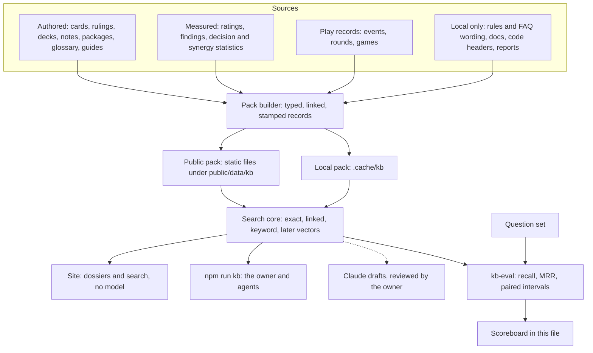

# Knowledge pack (kb): the retrieval plan

A living plan. It says what we are building, the method every step follows, what is done, and what is next.
Whoever lands a step updates the status board (§4), the scoreboard (§7) and the log (§10) in the same commit.

- Started: 2026-11-13, from six read-only research reports (authored knowledge, scored actions,
  competitive records, platform and query cost, AI game execution, outside tools and methods).
- Lines in this file are kept under about 110 characters so that search tools can show them.
- Related plan: `docs/TUNING_STUDY_2026-11-13.md` (change ledger P1, findings P2, evidence view P3).
  This plan reads what that one produces and does not build it a second time.

## 1. The end result

The work is finished when all of these are true.

1. **Ask and get the few records that answer.** A question about a card, ruling, rule, deck, package, event,
   ranking or the codebase returns a handful of records, each with its source and version, in about
   2,000 tokens or less from the local tool, and in 50 KB or less on the site.
2. **Numbers are exact.** Records, standings, rates and ratings are computed by code from recorded data.
   They are never recalled by a model and never matched by similarity.
3. **Every sentence follows the evidence rules.** Association is never worded as value or advice, a rate
   shows its sample and interval, and a measured record names its bot and sim version and is marked stale
   when that version is no longer current.
4. **The pack grows by rows.** A new card, note, ruling, event or finding becomes records at the next
   build, and only changed records are re-indexed.
5. **Every retrieval change is measured.** Nothing about ranking is kept unless the question set (§5,
   step 1.4) shows it helps on held-out questions.
6. **Bots never read it.** Recorded games replay identically, and no worker or bot imports the pack.

Not part of the end result: a hosted backend, a vector database, a model that visitors download by
default, and LLM-written text on the site that the owner has not reviewed.

## 2. Method

These rules hold in every step. A step that needs to break one says so in §8 first.

- **M1. Records, not chunks.** The unit of knowledge is a typed record built from a table the project
  already has (a card, a ruling, a deck note). It keeps the table's stable id and its links. Files are
  split into passages only where no table exists (docs, guides, rules text), and then by heading.
- **M2. The retrieval ladder.** Cheapest first: (1) exact id or name, (2) records one link away,
  (3) BM25 keyword ranking, (4) later, embeddings. The ranked lists are merged with reciprocal rank
  fusion (score = sum of weight / (60 + rank)), so adding a ranker later is a one-line change.
- **M3. Numbers by code.** A question whose answer is a number is answered by a function over the
  recorded data (§5, step 2.1). Retrieval finds which function and which entity; it does not find the number.
- **M4. Text by templates.** Sentences about measured facts are rendered at build time through the
  existing wording helpers (`coachWords`, `reviewWords`, `evidence.ts`, `simTierText`). Every record
  carries its origin (authored, imported, generated, measured, official) and, for notes, its status
  (draft or owner).
- **M5. Stamps and staleness.** A record that depends on a version carries it: sim version and bot for
  measured facts, list fingerprint for deck notes, rules and FAQ versions for rulings, card data version
  for cards. Each record has a content hash. Measured records from different sim versions are never pooled.
- **M6. Two scopes.** `public` records may be written under `public/`. `local` records come from
  `data/raw/` (official rules and FAQ wording, third-party pages) and are written only under `.cache/kb/`,
  which is gitignored. Nothing derived from `data/raw/` is ever written to a tracked file.
- **M7. One core, two homes.** Search and record code is pure TypeScript in `src/lib/kb/` (no DOM, no
  `node:` imports), so the site and the command line rank identically and Vitest covers both. Scripts do
  the file reading and writing.
- **M8. Deterministic builds.** The same inputs give byte-identical outputs: sorted listings, no wall
  clock, no locale-dependent formatting. Tracked outputs are written with `writeIfChanged`.
- **M9. Measure first.** A change to ranking is compared with the current configuration on the question
  set, tuned on the `dev` split and reported on the `test` split, with a paired interval.
  "Could not tell" is a valid result and means the simpler configuration stays.
- **M10. Kept away from play.** No file under `src/engine`, `src/ai` or `src/sim` imports `src/lib/kb`.
  The entry chunk never reaches it. A test enforces both.
- **M11. Small until measured.** No new runtime dependency and no model download until a measurement on
  the question set justifies it and the owner agrees.

## 3. How it fits together



Why this shape and not "split files, embed, let a model answer" (measured 2026-11-13):

- The corpus is small and already structured: 150 cards, 311 rulings, 47 library decks with notes,
  26 synergy packages, 54 glossary terms and about 60 guide sections. Every unit has a stable id and
  tested links. Chunking would discard both.
- Most questions name a thing or want an exact number. Sixteen card names belong to two or three cards,
  which similarity search confuses, and embeddings retrieve numbers poorly.
- The site cannot carry a model: a query encoder is a 23 to 34 MB download against a first visit of
  about 256 KB, and the worker bundles have about 34 kB of headroom.
- A plain scan of 100,000 vectors took 43 ms on the owner's machine, so size will not force a vector
  database. The real risk is staleness: `SIM_VERSION` went from 2 to 8 between 10 and 13 November.

## 4. Status board

Status is one of: done, in progress, next, blocked (with the reason), waiting (on a decision in §8).

| Step | Outcome | Status | Landed in |
|---|---|---|---|
| 0.1 | Play reads a small lift slice, not the whole synergy report | blocked: `Play.tsx` is being edited by the tutorial work | |
| 0.2 | Short `CLAUDE.md` core, per-directory files, wrapped doc lines | waiting: D7, and needs step 1.5 first | |
| 0.3 | FAQ-wording guard; quotes paraphrased; insights worded as association | next | |
| 1.1 | Record model and search core in `src/lib/kb/` | in progress | |
| 1.2 | Builders for authored, dev and local-only sources | in progress | |
| 1.3 | `npm run kb` (search, get, related, stats) | in progress | |
| 1.4 | Question set and `kb-eval` with first baselines | next | |
| 1.5 | Agent skill and a `CLAUDE.md` pointer | next | |
| 2.1 | Records query module: numbers by code | later | |
| 2.2 | Event, round and deck sheets from templates | later | |
| 2.3 | Findings as records | waiting: TUNING_STUDY P2 | |
| 2.4 | Decision, synergy and impact cells as keyed records | later | |
| 3.1 | Public pack, byte budgets, guards | waiting: D1, D2 | |
| 3.2 | Search and dossiers on the site behind a feature flag | waiting: D1, D2, D3 | |
| 4.x | Experiments: embeddings, reranker, related lists, drafted notes | waiting: step 1.4, D3, D4 | |
| 5.x | Exact reuse in game tools: coach cache, review measurements | later | |

## 5. Steps

Each step lists its goal, how to build it, the files it owns, and when it counts as done.

### Step 0. Slimming that needs no index

**0.1 Lift slice for Play.**
- Goal: Play stops downloading the whole synergy report (807 KB raw, 115 KB gzip) on every board mount
  to read one list's rows.
- How: derive one small file, `public/data/lift.json` (`kind: 'nct-lift'`, schema 1), holding exactly
  what `seatLift` in `src/ai/packageLift.ts` reads: the pooled rows and each list's rows (measured
  78.6 KB raw, 10.4 KB gzip for all 47 lists). Write it wherever `synergies.json` is written and in
  `npm run refresh`. Add a reader beside `useSynergyReport` in `src/ui/synergyReport.ts`, and have
  `Play.tsx` ask for it only when the coach is on. `check:data` verifies the slice equals the derivation.
- Done when: Play no longer requests `synergies.json`; the coach's package wording is unchanged on the
  pinned tests (`tests/coach-package-lift.test.ts`); the slice is checked for freshness.

**0.2 `CLAUDE.md` core and wrapped docs.**
- Goal: an agent session starts with about 2k tokens of rules instead of about 11k, and every doc line
  can be shown by a search tool (today about half the text in `CLAUDE.md` and `docs/` sits on lines of
  more than 500 characters, which the search tool replaces with "[Omitted long matching line]").
- How: keep in the root file only what must always be seen (replay determinism, plain state, bots read no
  log or report, no third-party loads, `data/raw` local-only and paraphrases only, the evidence wording
  rules, the entry-chunk rule and worker budgets, command-line conventions, the before-commit commands).
  Move each area's detail into a `CLAUDE.md` in that area's directory. Wrap long lines in `docs/`.
- Before starting: step 1.5 is done (so moved detail stays findable), no other session is editing
  `CLAUDE.md`, and nested-file loading has been checked in a throwaway session.

**0.3 Corpus hygiene.**
- Goal: the repository follows its own rules before an index copies its text around.
- How, part a: a guard test under `tests/faq/` fails when a tracked source, test or doc file shares ten
  or more consecutive words with the local FAQ (skipped when `data/raw` is absent; runs that also occur
  in a card's own text are ignored; the message names file, line and run length, never the text).
  Paraphrase the quotations it finds in test files now.
- How, part b: `src/engine/scripts/blue.ts` (near line 517) holds an 18-word match. Editing a card script
  changes the game-cache code hash and discards the cached games (168,784 under v8 on 2026-11-13), so
  that one comment is paraphrased at the next change that turns the cache over anyway. Until then the
  guard carries a single named exception for it.
- How, part c: `insights()` in `src/analysis/analyze.ts` turns win-rate association into instructions
  ("Keep these over everything when you sell or mulligan"). Reword as association, regenerate the stored
  sentences in `src/data/analysis.json` and the texts copied from them, and add a wording test.
- Until part c lands, pack builders do not read the `insights` arrays.

### Step 1. The pack and the local tool

**1.1 Record model and search core** (`src/lib/kb/`, pure).
- `types.ts`: the record model in §6.
- `text.ts`: tokenizer. Fold accents and quotes with `foldText` from `src/lib/cardMentions.ts`, lower-case,
  split on non-alphanumerics, drop a short stop-word list, strip a plural "s". No other stemming until
  the question set asks for it.
- `bm25.ts`: BM25 with k1 = 1.2 and b = 0.75 over title, aliases and text; title and alias tokens count
  three times.
- `names.ts`: exact lookup by id, by title and by alias, case-insensitive, returning every record that
  shares a name (two cards with one name are both returned).
- `search.ts`: the ladder of M2. Rankers produce ranked lists; `fuse` merges them by reciprocal rank
  fusion with weights (exact 2, linked 1, keyword 1 to start; tuned only on the `dev` split). Options:
  number of results, kinds, scope, which rankers run. A query with no hit above a floor returns
  "no match" rather than the nearest noise.
- `dossier.ts`: one record plus its neighbours grouped by link type, cut to a token budget.
- `render.ts`: plain-text and JSON output with id, title, kind, scope, origin, status, stamps, source
  path and a snippet of at most 300 characters; a token cap (characters divided by 4, a rough rule).

**1.2 Builders** (`src/lib/kb/build/` pure functions over data that scripts load).
- Authored, public scope: cards (`src/data/cards.json`), rulings (`tests/faq/entries/`, our paraphrases),
  library decks (`data/decks/*.txt` through the library rules), deck notes (`src/content/deckObjectives/`),
  synergy packages (`src/content/synergies/`), glossary terms and the two vocabularies, and guide
  sections split at second-level headings.
- Dev knowledge: `CLAUDE.md`, `README.md` and `docs/*.md` split by heading into passages of at most about
  120 words, and one record per source file from its opening comment block.
- Local scope, only when `data/raw/` is present: rules by numbered rule, official FAQ wording linked to
  its ruling, tournament rules and errata by section.
- Links come from fields that already exist (ruling to card, note to deck and key cards, package to
  members, guide to deck). Card names in prose are linked with the card-mention matcher; a mention that
  stays ambiguous is counted in the build report, never guessed.
- Not read yet: the `insights` arrays (step 0.3), archived decks (D9), `src/content/tutorial/` (in flux).

**1.3 Command line** (`scripts/kb.ts`, run as `npm run kb -- <command>`).
- `search "<question>"`, `get <id or name>`, `related <id or name>`, `stats`, `build`.
- Flags: `--kind`, `--scope public|local|all`, `--k`, `--json`, `--max-tokens`, `--rankers`.
- Follows the script conventions in `scripts/lib-node.ts`: `cli()` for `--help`, exit 2 on an unknown flag
  or bad value. The local pack is a cache in `.cache/kb/` (one record per line, plus a manifest of input
  hashes) rebuilt when an input changed.
- Output from a `local` record is labelled local-only so that it is not pasted into a tracked file.

**1.4 Question set and evaluation.**
- `data/kb/questions.json` (`kind: 'nct-kb-questions'`, schema 1): about 100 questions, each with the
  record ids that answer it, a type (entity, paraphrase, cross-entity, number, dev, rules), a scope and a
  split (`dev` 60, `test` 40). Written the way a player or a developer would ask, not by copying a
  record's wording. It starts as an agent-written draft (D8); the owner can edit it at any time.
- `scripts/kb-eval.ts`: recall at 1, 5 and 10 and MRR at 10, by type and split, for each configuration
  (exact only, plus linked, plus keyword, all fused), with a seeded paired bootstrap for the difference
  between two configurations and the mean and 90th-percentile answer size in tokens. Writes
  `reports/kb-eval-latest.md` and `.json`; rules questions are skipped when `data/raw` is absent.
- Done when: the scoreboard in §7 holds the first baselines and the weakest question type is named.

**1.5 Agent skill and pointer.**
- `.claude/skills/kb/SKILL.md` tells an agent when to call `npm run kb` instead of reading whole files,
  and a short bullet in `CLAUDE.md` points to this plan and the command.

### Step 2. Measured and competitive records

**2.1 Records query module** (pure, Node and browser).
- One correct definition per number: champion, standings after round k (export `computeStandings` from
  `src/lib/tournament.ts`), finishes with the real top cut, titles (custom events excluded), first-player
  split, end-reason mix, matchup (shrunk estimate with the raw record), rating and Sim tier with their
  range, and upsets judged against ratings fitted only on earlier events.
- Exposed as `npm run kb -- fact <name> ...` and to templates.

**2.2 Sheets.**
- One sheet per event, per round and per deck, rendered by templates from 2.1. A sheet is keyed on its
  template version, sim version, bot and a content hash of exactly the inputs it read. Event id, date and
  run id are not content identities: a re-recorded event keeps all three.
- Emitted in `npm run refresh` after a ratings step (today `refresh` does not rebuild ratings), and
  rejected by `check:data` when an input hash no longer matches.
- A richer round summary needs per-game Gig counts, which the tournament worker computes and the event
  writer drops (`scripts/worker.ts` lines 73 to 74 and 276 to 277); keeping them is about 15 bytes a game.

**2.3 Findings as records.**
- When `src/lib/findings.ts` and `public/data/evidence/` exist (TUNING_STUDY P2), each `Finding` becomes
  a `finding` record: same id, the cite line as text, its stamps, and `stale` carried through.

**2.4 Evidence cells.**
- Decision cells, synergy rows and impact rows (about 1,550 today) become keyed records with n, rate,
  interval, the gate fields (thin, association, lift gate) and one template sentence each, so that a
  question about one card on one list reads under 1 KB instead of a 547 KB file.

### Step 3. Site surface

- 3.1 Public pack: hashed shard names and a small manifest under `public/data/kb/`; budgets of nothing
  added to the entry chunk, 10 KB gzip of search code, 50 KB for a first query and 150 KB for the full
  index; a data budget in `tools/size-budget.ts`; freshness in `check:data`.
- 3.2 A search box and dossier panels (card rulings, deck profile) behind a `FEATURES` flag, loaded on
  intent only. Glossary search is repaired on the way (it matches JSON field names today).
- Waits on D1, D2 and D3, and on the tutorial work finishing its `siteConfig.ts` edits.

### Step 4. Experiments

Each experiment records its hypothesis, configuration, `dev` and `test` numbers, the paired interval,
the decision (keep, drop, could not tell) and its cost.

- 4.1 Embeddings computed on the owner's machine (bge-small-en-v1.5 or arctic-embed-s, 384 dimensions),
  scanned by a plain loop and fused by M2. Needs a dev dependency and a model download: owner approval.
- 4.2 A small cross-encoder reranking the top 50.
- 4.3 Precomputed "related" lists shipped to the site as id lists.
- 4.4 Per-card play notes drafted by Claude from dossiers, checked by a validator (no figure missing from
  the records, no figure past the caps, association wording) and reviewed by the owner before commit.
- 4.5 The baseline every index must beat: the whole public prose in one cached prompt (about 65k tokens;
  Anthropic's guidance is to skip retrieval under about 200k). 4.4 and 4.5 spend API money: owner approval.

### Step 5. Exact reuse in game tools

Stored knowledge saves almost nothing in bot play: positions do not repeat (two games of one list share
an opening hand about once in 10,000 to 30,000) and approximate reuse changes how bots play.

- 5.1 Cache coach answers by state hash, options and build: about 126 ms saved per Undo or resume.
- 5.2 Keep each review move's raw measurements, so a change of rating rules re-rates stored reviews in
  milliseconds instead of re-simulating 5 to 8 seconds each.
- 5.3 A repeat probe (exact, public and position keys per decision) before anything larger is considered.

## 6. Reference

**Record** (`src/lib/kb/types.ts`):

```ts
interface KbRecord {
  id: string;        // '<kind>:<stable key>', see the table below
  kind: KbKind;
  title: string;     // the name people use; boosted in search
  aliases?: string[];
  text: string;      // self-contained: the first sentence says what the thing is
  fields?: Record<string, string | number | boolean | null>; // flat facts for exact answers
  links: { rel: KbRel; to: string }[];
  source: { file: string; at?: string }; // path, and a line range or JSON pointer
  origin: 'authored' | 'imported' | 'generated' | 'measured' | 'official';
  scope: 'public' | 'local';
  status?: 'draft' | 'owner';
  stamps?: { simVersion?: number; bot?: string; rulesVersion?: string | null; faqVersion?: string | null;
             listId?: string; cardDataVersion?: string; asOf?: string };
  hash: string;      // fingerprintText over id, title, aliases, text, fields, links and stamps
}
```

**Ids.**

| Kind | Id | Example |
|---|---|---|
| card | `card:<card id>` | `card:<id from cards.json>` |
| ruling | `ruling:<first 8 of the FAQ id>` | the same prefix the FAQ tests use in `faq:<prefix>` |
| faq (local) | `faq:<first 8 of the FAQ id>` | official wording, linked from its ruling |
| rule (local) | `rule:<number>` | `rule:10.28` |
| deck | `deck:<file name without .txt>` | list fingerprint in `stamps.listId` and as an alias |
| objective | `objective:<deck file>` | |
| package | `pkg:<synergy id>` | |
| term | `term:<slug>` | signal and condition terms: `term:signal/<key>`, `term:condition/<key>` |
| guide | `guide:<slug>#<section slug>` | |
| doc | `doc:<path>#<heading slug>` | a long section adds `~2`, `~3` for later passages |
| code | `code:<path>` | the file's opening comment |
| later | `event:<id>`, `round:<event>/<n>`, `rating:<deck file>`, `finding:<id>` | step 2 |

**Link types**: `card`, `deck`, `package`, `ruling`, `rule`, `objective`, `guide`, `term`, `official`,
`test`, `parent`, `mentions`. Links are stored one way; the index adds the reverse direction when it loads.

**Local pack**: `.cache/kb/records.jsonl` (one record per line, sorted by id) and `.cache/kb/manifest.json`
(`kind: 'nct-kb'`, schema 1, counts by kind, a hash per input file, the rules, FAQ and card data versions).

**Command line**:

```bash
npm run kb -- search "which deck wins by filling the trash"
```

```bash
npm run kb -- get "Detonate"
```

## 7. Scoreboard

Numbers over time. A row is added when a step lands or an experiment ends; old rows stay.

| Date | What was measured | Result | Source |
|---|---|---|---|
| 2026-11-13 | Authored units | 150 cards, 311 rulings, 47 decks and notes, 26 packages, 54 terms | research |
| 2026-11-13 | Whole synergy report fetched by Play | 807 KB raw, 115 KB gzip; slice 10.4 KB gzip | research |
| 2026-11-13 | `CLAUDE.md` per agent session | about 11k tokens (bytes divided by 4) | research |
| 2026-11-13 | Text on lines over 500 characters in `CLAUDE.md` and `docs/` | 52% | research |
| | Pack: records by kind, size of the local pack | not measured yet | step 1.2 |
| | Question set: recall at 5 and MRR at 10 by configuration | not measured yet | step 1.4 |
| | Answer size from `kb search` | not measured yet | step 1.4 |

## 8. Decisions and stopgaps

The owner decides these. Until then the stopgap in the last column applies, and it is easy to reverse.

| # | Decision | Stopgap in force |
|---|---|---|
| D1 | First user: the owner and agents, or site visitors? | Local tool first; the site waits. |
| D2 | May the 311 FAQ paraphrases be shown to visitors as per-card rulings? | In the pack, not on the site. |
| D3 | LLM-written text on the site: none, reviewed drafts, or opt-in with the visitor's key? | None. |
| D4 | May a local tool send rules or FAQ wording to a hosted model? | No. Steps 0 to 3 call no API. |
| D5 | Old sim versions: keep as history or keep only the current one? | Current only; older marked stale. |
| D6 | "Top 8": any Swiss finish in the first eight, or a real top-cut appearance? | Unchanged; see below. |
| D7 | Restructure `CLAUDE.md` into a core plus per-directory files? | Not started. |
| D8 | Who writes the question set? | An agent drafts it, marked draft; the owner edits. |
| D9 | Archived and history decks in the pack? | Not yet; the 47 library decks only. |
| D10 | A nickname table for cards ("Smasher")? | None; ambiguous mentions are counted, not guessed. |

D6 in detail: `scripts/event-pool.ts` line 132 counts `i < 8`, even in 7-deck events that cut to four,
while the tournament index and the finish chips use the real cut, so five decks show two different counts.

## 9. Risks and guards

- **Version churn.** A sim version bump replaces every measured record. Guard: M5 stamps, the stale
  flag, and no pooling across versions.
- **Local text leaking into the site or the repo.** Guard: M6, the FAQ-wording guard test (step 0.3), and
  builders that read `data/raw` only for `local` records.
- **Determinism.** If bot code ever imported a kb module, each index rebuild would change the game-cache
  code hash and move the pins. Guard: M10 and its test.
- **Self-consistency.** Coach grades, review ratings and bot statistics all rest on the bots' own
  evaluation. "How to play a card" from that data describes what the bots do, as association.
- **Drafts read as fact.** None of the 91 deck notes or 26 packages is owner-confirmed. Guard: status is
  shown with every such record.
- **Same word, different meaning.** "Stage" has two definitions (`src/analysis/decisions.ts` and
  `src/ai/benchmark.ts`), "games" means different things in event standings, the index and ratings, and
  "review" names three things. Records name which definition they use.
- **Mixed versions after a deploy.** Files under `public/` are cached for ten minutes. Guard (step 3.1):
  hashed shard names behind one small manifest.

## 10. Log

- 2026-11-13: plan written from the research. Steps 1.1 to 1.3 started.
